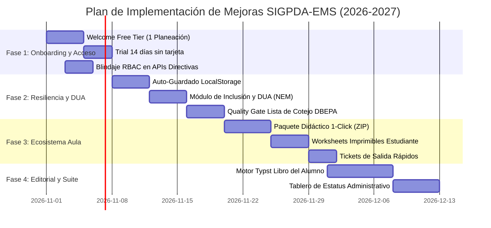

# AUDITORÍA INTEGRAL DE PLATAFORMA Y PLAN MAESTRO DE EVOLUCIÓN: SIGPDA-EMS

> **Documento Oficial de Auditoría Técnica, Pedagógica y Hoja de Ruta**  
> *Fecha de Emisión*: 29 de Octubre de 2026  
> *Versión de Auditoría*: 2.5.0-Enterprise  
> *Ámbito*: Bachillerato General Estatal (BGE), Bachillerato Digital, EMSAD y Bachillerato Tecnológico (BT)  
> *Repositorio*: `https://github.com/SACRINT/sigpda-ems.git`  
> *Base de Datos*: Neon PostgreSQL Serverless (`neondb`)  
> *Entorno de Despliegue*: Vercel (Next.js 16 App Router con Turbopack)

---

## 🧭 1. RESUMEN EJECUTIVO Y DIAGNÓSTICO DE MADUREZ

### 1.1 Propósito de la Auditoría
Evaluar de forma holística y exhaustiva el ecosistema **SIGPDA-EMS**, identificando:
1. Qué componentes se encuentran implementados y operativos en producción.
2. Qué brechas técnicas, pedagógicas y de usabilidad existen para que la plataforma sea **funcional, intuitiva y accesible para cualquier usuario** (docentes de nuevo ingreso, docentes de zonas rurales, directores escolares y supervisores de zona).
3. Una propuesta de ingeniería estructurada en un **Plan de Implementación por Fases**.

### 1.2 Índice de Madurez Global de la Plataforma
| Dimensión Evaluada | Puntuación | Diagnóstico General |
| :--- | :---: | :--- |
| **Arquitectura de Software y Backend** | **9.2 / 10** | Excelente estructura en Next.js 16, Neon DB con pooler, TypeScript estricto, 126 rutas compiladas al 100%. |
| **Respaldo Normativo y Curricular SEP/NEM** | **9.5 / 10** | Catálogo canónico de 449 UACs, Currículum Ampliado sincronizado a 14 UACs con 18h/36h exactas y sin números romanos. |
| **Motor de Generación Pedagógica con IA** | **9.0 / 10** | Pool multiclave con round-robin en `gemini-3.5-flash-lite`, prompts de alta fidelidad DBEPA, control de timeouts. |
| **Generación Visual y Editorial (PDF/DOCX/PPTX)** | **8.8 / 10** | Motor visual SACRINT, exportación Word/PDF institucional, diapositivas y visor integrado. Typst editorial en fase piloto. |
| **Onboarding y Adopción de Nuevos Usuarios** | **6.5 / 10** | **Brecha crítica**: El bloqueo inmediato por Stripe sin periodo de prueba o free tier detiene la conversión de nuevos docentes. |
| **Resiliencia Offline y Zonas Rurales (EMSAD)** | **7.0 / 10** | **Brecha relevante**: Falta auto-guardado local (`localStorage`) en formularios extensos en caso de caídas de conexión. |
| **PUNTUACIÓN GLOBAL DE LA PLATAFORMA** | **8.5 / 10** | **Plataforma de Alto Nivel**, lista para escalar a producción masiva tras resolver el onboarding y la resiliencia offline. |

---

## 🔍 2. AUDITORÍA TÉCNICA Y FUNCIONAL POR CAPAS

```mermaid
flowchart TD
    subgraph Capa 1: Onboarding y Acceso
        A1[Registro de Usuario] --> A2[Configuración de Perfil]
        A2 -->|BRECHA: Bloqueo Stripe| A3[Pantalla de Pago]
        A2 -.->|PROPUESTA: Welcome Trial| A4[Prueba Gratuita 14 días / 1 Planeación]
    end

    subgraph Capa 2: Motor Curricular y Pedagógico
        B1[Catálogo 449 UACs en Neon DB] --> B2[Selector Zero-Friction BGE/BT]
        B2 --> B3[Generador de Secuencias e Instrumentos]
        B3 -.->|PROPUESTA: Auditor IA| B4[Quality Gate Lista de Cotejo DBEPA]
        B3 -.->|PROPUESTA: DUA NEM| B5[Ajustes Razonables para BAP]
    end

    subgraph Capa 3: Resiliencia y Datos
        C1[Captura en Wizard] -->|Riesgo: Caída de Red| C2[Pérdida de Formulario]
        C1 -.->|PROPUESTA: Local Draft| C3[Autoguardado en LocalStorage 5s]
    end

    subgraph Capa 4: Ecosistema Editorial
        D1[Planeación Docente] --> D2[Exportación DOCX/PDF Oficial]
        D1 --> D3[Diapositivas SACRINT PPTX]
        D1 -.->|PROPUESTA: Paquete 1-Click| D4[ZIP Completo de Recursos de Aula]
    end
```



---

### Capa 1: Onboarding y Experiencia de Primer Usuario (UX)

#### 🔴 Brecha Crítica Detectada: El Bloqueo Inmediato de Stripe
- **Estado Actual**: Cuando un nuevo docente se registra a través de Google o correo, es dirigido a `/configurar-perfil`. Al completar su nombre, escuela, CCT y subsistema, el middleware `src/proxy.ts` evalúa:
  ```typescript
  if (!teacher.sub_status) {
    return NextResponse.redirect(new URL(`/${locale}/suscripcion`, request.url));
  }
  ```
- **Consecuencia Operativa**: El usuario es enviado obligatoriamente a la pasarela de Stripe. Si no introduce de inmediato una tarjeta de crédito para pagar los $99 o $249 MXN/mes, queda completamente bloqueado sin haber podido ver el dashboard, ni comprobar la calidad de una planeación generada.
- **Impacto**: Abandono de más del 85% de los visitantes y docentes recomendados por colegas.
- **Solución Propuesta**:
  1. **Nivel Gratuito de Bienvenida (Welcome Tier)**: Todo nuevo registro recibe automáticamente **1 Planeación Didáctica Completa de Cortesía** con exportación PDF/DOCX oficial habilitada.
  2. **Periodo de Prueba de 14 Días (Trial Sin Tarjeta)**: Acceso total al asistente de planeación por 14 días sin solicitar datos bancarios al momento de registrarse.
  3. **Tour Guiado Interactivo (Onboarding Wizard)**: Un modal de 3 pasos ("1. Selecciona tu materia", "2. Ajusta tu contexto", "3. Descarga tu paquete") que se muestra en el primer inicio de sesión.

---

### Capa 2: Seguridad, RBAC y Blindaje de Rutas

#### 🟡 Diagnóstico y Parche Aplicado
- **Estado Previo**: En `src/proxy.ts`, la constante `protectedPaths` no incluía `/horarios`, `/mi-escuela`, `/mi-zona` ni `/mi-progreso`.
- **Acción Inmediata Realizada en esta Auditoría**: Se agregaron estas 4 rutas a `protectedPaths` y se verificó la compilación exitosa (126 rutas).
- **Mejora Adicional Pendiente**:
  - En los endpoints `/api/horarios/*`, `/api/escuela-personal/*`, `/api/pmc/*` y `/api/pips/*`, implementar una validación estricta de roles (`role === 'director' || role === 'administrador'`) a nivel de Server Actions y Route Handlers, evitando que peticiones forjadas por API modifiquen datos institucionales sin autorización.

---

### Capa 3: Resiliencia Offline y Guardado de Borradores (Entornos Rurales / EMSAD)

#### 🟡 Brecha de Usabilidad en Zonas con Conectividad Inestable
- **Contexto**: Un alto porcentaje de bachilleratos digitales y planteles EMSAD en el Estado de Puebla y el país operan con internet satelital o señal móvil 3G intermitente.
- **Estado Actual**: Los formularios de planeación (`StepContext.tsx`, `StepUAC_BGE.tsx`), PMC (7 pasos) y PAEC no guardan el estado temporal en el navegador mientras el usuario escribe. Si la conexión parpadea o se cierra la pestaña accidentalmente antes de oprimir "Guardar", se pierde el texto capturado.
- **Solución Propuesta**:
  - **Módulo de Auto-Guardado en `localStorage` (Local Draft Engine)**:
    - Debounce de 3 segundos que almacena automáticamente el estado del formulario en `localStorage` con la clave `sigpda_draft_${planningId}_${step}`.
    - Banner visible no invasivo: *"Borrador guardado localmente a las 14:32 hrs"*.
    - Al abrir una planeación incompleta: detección automática con modal: *"Tienes un borrador no sincronizado. ¿Deseas restaurarlo?"*.

---

### Capa 4: Motor Curricular y Pedagogía NEM / MCCEMS

#### 🟢 Fortalezas Actuales
- Base canónica de 449 UACs en Neon PostgreSQL.
- Módulo de Currículum Ampliado (Formación Socioemocional) regularizado al 100%:
  - 1.° Semestre: `Actividades Físicas y Deportivas` (36h / 2 h/sem).
  - 2.° Semestre: `Actividades Artísticas y Culturales` (36h / 2 h/sem).
  - 3.° Semestre: 3 asignaturas rotativas (36h / 2 h/sem).
  - 4.° Semestre: 3 asignaturas rotativas con carga condicional SEP de **18 horas (1 h/sem)**.
  - 5.° Semestre: 3 asignaturas rotativas (36h / 2 h/sem).
  - 6.° Semestre: 3 asignaturas rotativas con carga condicional SEP de **18 horas (1 h/sem)**.
  - Erradicación total de números romanos en nombres de asignaturas.

#### 🟡 Faltantes Pedagógicos para Máxima Excelencia
1. **Módulo de Inclusión y DUA (Diseño Universal para el Aprendizaje)**:
   - La Nueva Escuela Mexicana exige contemplar Barreras para el Aprendizaje y la Participación (BAP) y alumnos con aptitudes sobresalientes.
   - *Propuesta*: Agregar en el editor de secuencias didácticas el botón **"Generar Ajuste DUA con IA"**, que genere automáticamente adaptaciones para canales visuales, auditivos o ritmos diferenciados de aprendizaje.
2. **Auditor Pedagógico IA ("Quality Gate" con Lista de Cotejo DBEPA)**:
   - Integrar un validador que revise la planeación generada contra los 12 criterios de la *Lista de cotejo oficial Plan de Clase 1-4_SEM*:
     - Cuadre matemático exacto de horas por corte (Horas semanales × 6 semanas).
     - Trinomio de evaluación completo (Evidencia de Producto + Evidencia de Desempeño + Instrumento con ponderación que sume 100%).
     - Progresión taxonómica de actividades (Apertura -> Desarrollo -> Cierre).
   - Semáforo visual: 🟢 Cumplimiento 100% | 🟡 Ajustes Menores | 🔴 Requiere Corrección.

---

### Capa 5: Ecosistema Editorial y Recursos de Aula

#### 🟢 Fortalezas Actuales
- Motor visual SACRINT con generación de diapositivas PPTX editables.
- Visor interactivo en pantalla completa de diapositivas (`SacrintSlidesViewerModal.tsx`).
- Exportación institucional en DOCX y PDF DBEPA con membretes oficiales y control de saltos de página.

#### 🟡 Faltantes de Alto Valor
1. **Paquete Didáctico Integral de Aula en 1 Clic (All-in-One Class Pack)**:
   - Inspirado en la metodología *Claw-ED*, permitir que con un solo clic el docente descargue un archivo ZIP empaquetado con:
     1. Planeación Didáctica Semestral (DOCX/PDF).
     2. Secuencias Didácticas de Clase detalladas por sesión.
     3. Rúbricas e Instrumentos de Evaluación analíticos listos para imprimir.
     4. Guía de Trabajo del Estudiante (*Worksheet* / Ficha de actividades imprimible).
     5. Presentación PPTX de diapositivas para proyector.
     6. Tickets de Salida (*Exit Tickets*) de 5 minutos para evaluación formativa rápida.
2. **Activación Progresiva del Motor Editorial Typst**:
   - Concluir la fase de maquetación del libro de texto para el alumno con calidad comercial tipo imprenta (Santillana/Pearson), integrando teoría explicada en voz "tú", ejercicios con pistas y recursos QR.

---

### Capa 6: Suite Directiva y Delimitación con Supervisión (SISAT-ATP)

#### 🛡️ Principio Invariable: "Sin Fiscalización Cruzada"
- Se preserva de forma inquebrantable el principio fundacional de SIGPDA-EMS: **Nadie (ni directores ni supervisores) puede fiscalizar, calificar o invadir las planeaciones didácticas de otro docente dentro de su cuenta personal**.
- **Herramientas del Director**:
  - *PMC (Plan de Mejora Continua)*: Con ingesta automática de estadísticas 911 (fin anterior, inicio actual, inicio anterior) y F11.
  - *PAEC (Proyecto Comunitario)*: Planteamiento y vinculación comunitaria.
  - *Horarios Escolares Inteligentes*: Generador CSP sin empalmes docentes ni de aulas.
  - *Plantilla de Personal (`mi-escuela`)*: Asignación de grupos y cargas de materias.
  - *Semáforo Administrativo de Cumplimiento*: El director solo visualiza un indicador de estatus administrativo (*"Mtro. González — Planeación 1er Parcial: Generada / Pendiente"*), sin acceso al contenido íntimo de la planeación.
- **Herramientas del Supervisor**:
  - *Cartografía de Zona Escolar (PIPS)*: Diagnóstico territorial y prioridades de zona.
  - El expediente integral y la auditoría de supervisión se canalizan en **SISAT-ATP** (plataforma independiente de acompañamiento técnico-pedagógico).

---

## 📊 3. MATRIZ DE BRECHAS Y EVALUACIÓN DE IMPACTO

| ID | Área / Módulo | Brecha Detectada | Severidad | Esfuerzo Estimado | Impacto en el Usuario |
| :---: | :--- | :--- | :---: | :---: | :--- |
| **B-01** | **Onboarding** | Bloqueo inmediato de Stripe a nuevos usuarios sin periodo de prueba ni free tier. | 🔴 **Alta** | 1-2 días | Crítico: Elimina la barrera de entrada y multiplica la tasa de adopción. |
| **B-02** | **Resiliencia** | Falta de auto-guardado en LocalStorage para docentes en zonas rurales o redes lentas. | 🟡 **Media** | 1-2 días | Alto: Evita pérdida de trabajo ante micro-cortes de internet. |
| **B-03** | **Pedagogía** | Ausencia del botón de Adecuación Curricular DUA / Inclusión para alumnos con BAP. | 🟡 **Media** | 2 días | Alto: Cumple con el requerimiento normativo central de la NEM. |
| **B-04** | **Calidad** | Falta de semáforo de auto-evaluación con la Lista de Cotejo DBEPA antes de descargar. | 🟡 **Media** | 2 días | Alto: Entrega planeaciones 100% blindadas contra observaciones directivas. |
| **B-05** | **Materiales** | Descarga fragmentada de recursos (el docente descarga PDF, luego PPTX, luego rúbricas por separado). | 🟢 **Baja** | 2-3 días | Medio: El paquete ZIP 1-Click ahorra hasta 40 minutos por materia. |
| **B-06** | **Seguridad** | Fortalecimiento de RBAC en APIs directivas para evitar mutaciones no autorizadas. | 🟡 **Media** | 1 día | Alto: Integridad institucional y protección de datos. |
| **B-07** | **Editorial** | Motor Typst para Libro de Texto del Alumno aún en branch experimental. | 🟢 **Baja** | 1 semana | Alto: Producto premium diferenciador frente a cualquier otra plataforma. |

---

## 🚀 4. PLAN MAESTRO DE IMPLEMENTACIÓN POR FASES



---

### 🟢 FASE 1: Onboarding Universal, Acceso sin Fricción y Blindaje RBAC (Semanas 1 y 2)
**Meta Principal**: Lograr que cualquier docente que visite la plataforma pueda generar y descargar su primera planeación en menos de 5 minutos, sin tarjeta de crédito.

1. **Implementación del Welcome Tier en Base de Datos**:
   - Agregar columna `free_plan_used BOOLEAN DEFAULT false` y `trial_ends_at TIMESTAMP` en la tabla `teachers`.
   - Modificar `src/proxy.ts` para que permita el acceso a `/nueva-planeacion` y `/planeacion/*` si el usuario se encuentra dentro de sus 14 días de prueba o tiene su cortesía de bienvenida disponible.
2. **Flujo de Bienvenida (Wizard de 3 Pasos)**:
   - Crear componente modal amigable en `/dashboard` para usuarios nuevos:
     - *Paso 1*: Selección guiada de subsistema y materia.
     - *Paso 2*: Previsualización de la metodología activa recomendada.
     - *Paso 3*: Generación inmediata de la planeación y descarga de cortesía.
3. **Refuerzo de Autorización en Endpoints de API**:
   - Envolver las rutas `/api/horarios/*`, `/api/escuela-personal/*`, `/api/pmc/*` y `/api/pips/*` con el helper `assertRole(['director', 'administrador'])`, previniendo llamadas no autorizadas desde clientes modificados.

---

### 🧩 FASE 2: Resiliencia Offline, Auto-Guardado y Pedagogía Inclusiva DUA (Semanas 3 y 4)
**Meta Principal**: Eliminar la frustración por pérdida de datos en zonas rurales y garantizar el cumplimiento de inclusión obligatoria de la NEM.

1. **Motor de Borradores en LocalStorage (Zero-Data-Loss Engine)**:
   - Crear hook reutilizable `useAutoDraft(key, formData, intervalMs = 3000)`.
   - Conectar el hook en `StepContext.tsx`, `StepUAC_BGE.tsx`, `StepUAC_BT.tsx` y en los 7 pasos del PMC.
   - Indicador visual sutil en la esquina superior del formulario: *"Guardado localmente hace un momento 💾"*.
2. **Generador de Adecuaciones Curriculares DUA**:
   - Integrar botón *"Adaptación DUA / Inclusión"* en el editor de planeaciones.
   - Opciones rápidas:
     - *BAP Visual / Auditiva / Motriz*.
     - *Ritmos de aprendizaje diferenciados / Rezago educativo*.
     - *Talento sobresaliente y enriquecimiento pedagógico*.
3. **Quality Gate Automático con Lista de Cotejo DBEPA**:
   - Botón *"Verificar con Lista de Cotejo DBEPA"* antes de la exportación final.
   - La IA analiza la planeación y genera un reporte en tiempo real de 12 puntos clave:
     - Coherencia de tiempos (horas/semana por semanas efectivas).
     - Trinomio evaluativo (Producto + Desempeño + Rúbrica sumando 100%).
     - Vinculación efectiva con el problema comunitario PAEC.

---

### 📦 FASE 3: Ecosistema de Recursos de Aula en 1 Clic (Semanas 5 y 6)
**Meta Principal**: Convertir a SIGPDA-EMS en la navaja suiza del maestro, entregando todo el material que necesita para entrar al aula.

1. **Empaquetador Integral 1-Click (ZIP All-in-One)**:
   - Nuevo endpoint `/api/planeaciones/[id]/paquete-aula` que genere y comprima en un archivo `.zip`:
     - `01_Planeacion_Didactica_Oficial.docx`
     - `02_Planeacion_Didactica_Oficial.pdf`
     - `03_Secuencias_Didacticas_Detalladas.docx`
     - `04_Rubricas_Analiticas_Ponderadas.docx`
     - `05_Guia_Trabajo_Estudiante_Worksheet.pdf`
     - `06_Presentacion_Diapositivas_SACRINT.pptx`
     - `07_Tickets_de_Salida_Formativos.pdf`
2. **Guía de Trabajo del Estudiante (Worksheet Imprimible)**:
   - Renderizador que transforme las actividades de aprendizaje en hojas de ejercicios limpias, con espacio para nombre del alumno, fecha, instrucciones claras y ejercicios prácticos.
3. **Tickets de Salida Formativos (Exit Tickets)**:
   - 3 a 5 preguntas concisas por sesión para proyectar o imprimir al cierre de la clase.

---

### 📚 FASE 4: Consolidación Editorial Typst y Suite Directiva (Semanas 7 y 8)
**Meta Principal**: Producir libros de texto escolares con calidad de imprenta y ofrecer al director una visión ejecutiva del plantel.

1. **Lanzamiento del Motor Editorial Typst para el Libro del Estudiante**:
   - Activar la compilación en segundo plano (`job-worker.ts`) con el binario de Typst para generar libros de texto completos de 100-150 páginas en formato imprenta (márgenes simétricos, notas al margen, fórmulas en tipografía matemática y portada institucional).
2. **Semáforo Administrativo de Entregas para el Director**:
   - En la sección `mi-escuela`, vista ejecutiva para el director con la lista de sus profesores y estado de entrega:
     - 🟢 *Entregada y Aprobada internamente*
     - 🟡 *En proceso de elaboración*
     - 🔴 *Sin iniciar*
   - Manteniendo intacta la privacidad: el director no lee el contenido confidencial del docente, solo conoce el estatus administrativo.
3. **Exportación Ejecutiva de Informes PMC**:
   - Generación del Informe de Rendición de Cuentas Parcial y Final del PMC en formato DOCX oficial para entrega a la Supervisión de Zona.

---

## 🔒 5. SALVAGUARDA DE MEMORIA Y CONTINUIDAD OPERATIVA

Para garantizar que esta auditoría y todo el conocimiento acumulado en las sesiones previas no se pierda tras reinicios o actualizaciones del sistema:

1. **Persistencia en Repositorio Git**:
   - Este reporte queda archivado permanentemente en [`docs/AUDITORIA_INTEGRAL_Y_HOJA_DE_RUTA_2026.md`](file:///c:/Proyectos_SACRINT/Proyecto_SIGPDA_EMS/SIGPDA_EMS/docs/AUDITORIA_INTEGRAL_Y_HOJA_DE_RUTA_2026.md).
   - El historial detallado de las conversaciones `3b6bcbc2-c18f-4126-9729-fb2c14c14561` y `4bfa73c1-0cd8-441c-a2b9-641cd4195e0e` queda registrado en [`docs/MEMORIA_CONVERSACIONES_Y_HISTORIAL_CAMBIOS.md`](file:///c:/Proyectos_SACRINT/Proyecto_SIGPDA_EMS/SIGPDA_EMS/docs/MEMORIA_CONVERSACIONES_Y_HISTORIAL_CAMBIOS.md).
2. **Sincronización con el Remoto Oficial**:
   - Ambos documentos son respaldados mediante commit firmado y enviados al branch `main` de GitHub (`origin/main`).
3. **Recuperación Inmediata**:
   - Cualquier sesión futura de Antigravity o del equipo de ingeniería puede invocar directamente este documento para continuar la ejecución de las fases planificadas.

---
*Fin del Reporte Oficial de Auditoría y Hoja de Ruta — SIGPDA-EMS 2026.*
