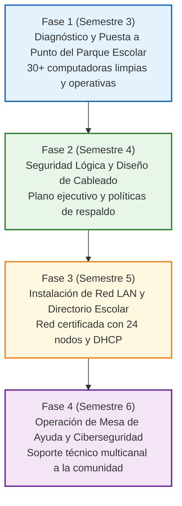

# Guía Didáctica de Oficio para el Docente — Computación y Redes 2024

**Formación Laboral Básico — Bachillerato General Estatal (BGE)**  
**Generación 2023–2026 · Acuerdo 09/08/23 · SEP Puebla · MCCEMS**

**Versión 1.0 · 2026-11-12**

---

## 1. Ficha de identificación institucional

| Campo | Valor |
| --- | --- |
| Componente | Formación Laboral Básico, Nivel 2 |
| Subsistema | Bachillerato General Estatal (BGE) |
| Generación | 2023–2026 |
| Acuerdo | Acuerdo número 09/08/23 (MCCEMS) |
| Documento oficial | `Redes_y_Mantenimiento_2024.pdf` (SEP Puebla, 166 pp.) |
| Páginas de referencia | 20–24 (mapa de competencias) y 25–205 (UACs y procesos) |
| Duración | 4 semestres: 3.º, 4.º, 5.º y 6.º |
| UAC | 8 |
| Actividades clave | 24 (3 por UAC; 6 por semestre) |
| Carga horaria | 432 h: 54 h por UAC, 3 h semanales, 3 bloques de 18 h |
| Proyecto integrador | Taller Comunitario de Mantenimiento de Cómputo y Conectividad Escolar |
| Ocupaciones | SINCO 2019: 2651 y 3114 · SCIAN 2023: 811211, 541512 y 611122 |

**Mapa de las 8 UAC:**

| Semestre | Código | UAC | Horas | Prerrequisitos | Hito del proyecto |
| --- | --- | --- | --- | --- | --- |
| 3.º | CR-3.1 | Actualiza equipos de cómputo de acuerdo con especificaciones del fabricante | 54 | — | Diagnóstico y actualización de hardware/software |
| 3.º | CR-3.2 | Usa técnicas y estrategias de mantenimiento del equipo de cómputo | 54 | CR-3.1 | Mantenimiento preventivo/correctivo y bitácoras |
| 4.º | CR-4.1 | Establece seguridad informática en equipos de cómputo | 54 | CR-3.2 | Blindaje de seguridad y respaldo 3-2-1 |
| 4.º | CR-4.2 | Planea infraestructura de red internet e intranet en un entorno con supervisión del experto | 54 | CR-4.1 | Diseño ejecutivo de cableado estructurado |
| 5.º | CR-5.1 | Administra redes de acuerdo con las condiciones y requerimientos de una organización | 54 | CR-4.2 | Conectorización y certificación de red LAN |
| 5.º | CR-5.2 | Brinda soporte en software de aplicación y hardware según los requerimientos del usuario | 54 | CR-5.1 | Administración de usuarios, cuotas y permisos |
| 6.º | CR-6.1 | Asesora sobre directrices de seguridad en redes y equipos de cómputo a usuarios | 54 | CR-5.2 | Campañas de ciberseguridad comunitaria |
| 6.º | CR-6.2 | Ofrece soporte en software de aplicación y hardware según los requerimientos del usuario | 54 | CR-6.1 | Operación de la mesa de ayuda multicanal |

---

## 2. Seguridad en taller y protocolos normativos

> **Principio rector:** La seguridad del alumnado y la protección de los equipos son inviolables. Ningún procedimiento de ensamblaje o mantenimiento se realiza con equipos energizados, y es mandatario el uso de protección contra descargas electrostáticas (ESD).

### 2.1 Marco normativo aplicable al laboratorio y taller de cómputo

| Norma / Referencia | Propósito | Aplicación en el Taller |
| --- | --- | --- |
| NOM-001-SEDE-2012 | Instalaciones eléctricas de utilización. | Líneas de alimentación reguladas con tierra física verificada; uso de contactos polarizados y supresores de picos. |
| ANSI/ESD S20.20 | Control de descargas electrostáticas en electrónica. | Pulsera antiestática obligatoria con conexión a chasis desenergizado; tapetes disipativos para componentes sensibles. |
| TIA/EIA-568-D | Estándares de cableado estructurado para telecomunicaciones. | Terminación de conectores RJ-45 bajo norma A o B, respetando radio de curvatura y distancias máximas de 90 m en canal horizontal. |
| NOM-019-STPS-2011 | Comisiones de seguridad e higiene. | Bitácoras de inspección de extintores CO2 tipo BC/C y ventilación de químicos (alcohol isopropílico, solventes). |
| ISO/IEC 27001 | Seguridad de la información y privacidad de datos. | Respaldo periódico cifrado, confidencialidad de datos personales de usuarios y políticas de contraseñas robustas. |

### 2.2 Reglas de oro del taller de cómputo y redes

1. **Desconexión Total de Energía:** Desconectar la fuente de poder del toma de corriente de 127 V y presionar el botón de encendido durante 10 segundos para descargar condensadores antes de abrir el chasis.
2. **Protección Anti-ESD Activa:** Colocar la pulsera antiestática en la muñeca y sujetar la pinza caimán a una superficie metálica sin pintura antes de manipular procesadores, tarjetas madre o memorias RAM.
3. **Uso de Insumos Dieléctricos:** Emplear exclusivamente alcohol isopropílico al 99.7% y pasta térmica certificada. Prohibido el uso de solventes caseros o agua.
4. **Inspección de Herramientas:** Utilizar destornilladores de precisión no magnéticos o de bajo magnetismo, pinzas de corte al ras y herramientas de crimpado calibradas.
5. **Trabajo en Parejas con Registro:** Toda intervención técnica se realiza en binas y se documenta en la orden de servicio correspondiente.

---

## 3. Fichas didácticas de las 24 actividades clave en sus tres momentos

Cada una de las 24 actividades clave se desarrolla en tres momentos metodológicos rigurosos:
- **Momento 1: Demostración Docente (Modelado guiado y explicación de principios técnicos).**
- **Momento 2: Práctica Guiada (Ejecución colaborativa en binas con andamiaje y supervisión).**
- **Momento 3: Reto Autónomo (Resolución individual o en equipo de un caso técnico simulado).**

---

### SEMESTRE 3 — MÓDULO 1: ACTUALIZACIÓN Y MANTENIMIENTO DE EQUIPO

#### CR-3.1 Actualiza equipos de cómputo de acuerdo con especificaciones del fabricante

##### Actividad Clave 1 (CR-3.1-A1): Realiza reparaciones menores al hardware siguiendo especificaciones de instalación con supervisión de un profesional (18 h)
- **Momento 1 — Demostración:** El docente modela la identificación de componentes internos (microprocesador, socket, bancos DIMM, ranuras PCIe, conectores SATA y M.2 NVMe) y periféricos de red (tarjeta NIC, repetidores, módem), explicando las especificaciones de compatibilidad del fabricante y las normas ESD.
- **Momento 2 — Práctica Guiada:** En binas con pulsera antiestática, los estudiantes inspeccionan computadoras del laboratorio, registran marca, modelo y especificaciones en una tabla técnica, desmontan módulos de memoria RAM y unidades de disco, y verifican su correcta inserción.
- **Momento 3 — Reto Autónomo:** Diagnosticar una computadora con falla de inicio inducida (RAM mal asentada o cable SATA desconectado), aislar el componente responsable, corregir la conexión y verificar que el POST de la BIOS reconozca el hardware.
- **Evidencia:** Ficha de inspección técnica de hardware con verificación fotográfica y firma del docente.

##### Actividad Clave 2 (CR-3.1-A2): Actualiza software para satisfacer las necesidades operativas del usuario con supervisión de un profesional (18 h)
- **Momento 1 — Demostración:** El docente explica las diferencias entre BIOS legacy y UEFI, el esquema de particionado GPT vs MBR, y modela la creación de un medio de instalación USB booteable de sistema operativo con herramienta oficial.
- **Momento 2 — Práctica Guiada:** Los alumnos configuran el orden de arranque en el firmware UEFI, realizan una instalación limpia de sistema operativo, instalan controladores oficiales (chipset, audio, video, red) y suites ofimáticas requeridas.
- **Momento 3 — Reto Autónomo:** Configurar una estación de trabajo con doble sistema operativo o restaurar los controladores oficiales tras una simulación de incompatibilidad gráfica.
- **Evidencia:** Lista de verificación de instalación de sistema operativo y reporte de controladores activos sin advertencias en el Administrador de Dispositivos.

##### Actividad Clave 3 (CR-3.1-A3): Verifica rendimiento de la red y sus dispositivos con supervisión de un profesional (18 h)
- **Momento 1 — Demostración:** El docente explica los parámetros de rendimiento de tarjetas de interfaz de red (NIC Ethernet 10/100/1000 Mbps y Wi-Fi 802.11ac/ax), modelando pruebas de velocidad, atenuación y diagnóstico con comandos de consola.
- **Momento 2 — Práctica Guiada:** Los estudiantes configuran adaptadores de red, ejecutan comandos `ipconfig /all`, `ping` a puerta de enlace y DNS, y registran tiempos de latencia y porcentaje de paquetes perdidos.
- **Momento 3 — Reto Autónomo:** Resolver un problema de conectividad por configuración incorrecta de adaptador (IP estática fuera de rango o DHCP inactivo) y restablecer el tráfico de red.
- **Evidencia:** Bitácora de verificación de rendimiento de red con capturas de pantalla de pruebas de conectividad y análisis de latencia.

---

#### CR-3.2 Usa técnicas y estrategias de mantenimiento del equipo de cómputo

##### Actividad Clave 1 (CR-3.2-A1): Realiza mantenimiento preventivo con supervisión de un profesional (18 h)
- **Momento 1 — Demostración:** El docente realiza una limpieza física integral: desensamble de chasis, aspirado y soplado con aire comprimido, limpieza de ventiladores y disipador, remoción de pasta térmica seca y aplicación de pasta térmica de alta conductividad.
- **Momento 2 — Práctica Guiada:** Los equipos limpian gabinetes escolares asignados siguiendo un protocolo de 10 pasos, asegurando que ningún ventilador gire descontroladamente con el flujo de aire y limpiando contactos dorados con goma estática.
- **Momento 3 — Reto Autónomo:** Realizar el mantenimiento preventivo completo de una torre escolar en menos de 45 minutos, dejándola libre de polvo, con temperaturas de CPU monitoreadas y reportadas.
- **Evidencia:** Bitácora de mantenimiento preventivo con registro de temperaturas previas y posteriores a la intervención.

##### Actividad Clave 2 (CR-3.2-A2): Realiza mantenimiento correctivo con supervisión de un profesional (18 h)
- **Momento 1 — Demostración:** El docente expone el árbol de decisiones para diagnóstico de fallas: códigos de beeps de la placa base, pantallas azules de error (BSOD), fallas de fuente de poder probadas con tester de fuentes ATX y fallas de sectores de disco duro.
- **Momento 2 — Práctica Guiada:** Con estaciones de trabajo con fallas documentadas, los estudiantes aplican software de diagnóstico de disco (CrystalDiskInfo) y pruebas de memoria (MemTest86), diagnosticando el componente defectuoso.
- **Momento 3 — Reto Autónomo:** Sustituir una fuente de poder averiada por una funcional, verificando voltajes (+12V, +5V, +3.3V) con multímetro antes de conectar a la placa madre.
- **Evidencia:** Orden de servicio de mantenimiento correctivo con descripción de la falla, diagnóstico, acción realizada y pruebas de aceptación.

##### Actividad Clave 3 (CR-3.2-A3): Aplica software de gestión y planificación de mantenimiento con supervisión de un profesional (18 h)
- **Momento 1 — Demostración:** El docente presenta el funcionamiento de un sistema de tickets y hojas de inventario técnico computacional (hardware, número de serie, ubicación, fecha de mantenimiento).
- **Momento 2 — Práctica Guiada:** Los alumnos inventarían el equipo del aula de medios, etiquetan los gabinetes con códigos de identificación y programan el calendario de mantenimientos del ciclo escolar.
- **Momento 3 — Reto Autónomo:** Simular la recepción de un ticket de servicio, asignar prioridad, registrar la intervención técnica y dar cierre con conformidad del usuario.
- **Evidencia:** Base de datos de inventario técnico y reporte de programación anual de mantenimiento preventivo del plantel.

---

### SEMESTRE 4 — MÓDULO 2: SEGURIDAD INFORMÁTICA Y DISEÑO DE REDES

#### CR-4.1 Establece seguridad informática en equipos de cómputo

##### Actividad Clave 1 (CR-4.1-A1): Protege red de una organización con las medidas de seguridad de los sistemas operativos con supervisión de un profesional (18 h)
- **Momento 1 — Demostración:** El docente modela la configuración de reglas de entrada y salida en el Firewall de Windows y en iptables de GNU/Linux, bloqueando puertos vulnerables no utilizados (ej. Telnet 23, SMB 445 si no se requiere).
- **Momento 2 — Práctica Guiada:** Los estudiantes crean cuentas de usuario estándar sin privilegios administrativos para los alumnos, establecen políticas de contraseñas complejas y configuran reglas de bloqueo de puertos en sus estaciones.
- **Momento 3 — Reto Autónomo:** Probar mediante un escáner de puertos local que los puertos restringidos se encuentren en estado *closed* o *filtered*.
- **Evidencia:** Reporte de directivas de seguridad locales y captura de auditoría de puertos.

##### Actividad Clave 2 (CR-4.1-A2): Utiliza Apps y programas de amenazas exteriores para proteger sistemas, datos y redes con supervisión de un profesional (18 h)
- **Momento 1 — Demostración:** El docente analiza el funcionamiento de malware moderno (troyanos, ransomware, spyware) y demuestra la configuración de software antimalware con análisis heurístico y protección en tiempo real.
- **Momento 2 — Práctica Guiada:** Los estudiantes configuran soluciones antivirus en el laboratorio escolar, programan análisis automáticos semanales y crean listas blancas y de exclusión controladas.
- **Momento 3 — Reto Autónomo:** Desinfectar una unidad flash USB infectada con accesos directos ocultos mediante comandos de consola (`attrib -h -r -s /s /d`) y análisis antimalware.
- **Evidencia:** Bitácora de análisis y desinfección con procedimiento técnico documentado.

##### Actividad Clave 3 (CR-4.1-A3): Mantiene seguros los datos de una organización a través de la infraestructura, las aplicaciones y las plataformas en línea con supervisión de un profesional (18 h)
- **Momento 1 — Demostración:** El docente explica la regla 3-2-1 de respaldo (3 copias de datos, 2 medios distintos, 1 copia fuera de sitio o nube) y modela el cifrado de volúmenes con BitLocker o VeraCrypt.
- **Momento 2 — Práctica Guiada:** Los alumnos configuran copias de seguridad incrementales automatizadas de carpetas administrativas del plantel hacia un disco duro externo y una cuenta institucional en nube.
- **Momento 3 — Reto Autónomo:** Realizar una prueba de recuperación de desastres: borrar intencionalmente una carpeta de prueba y restaurarla íntegramente desde la copia de seguridad cifrada.
- **Evidencia:** Plan de contingencia y respaldo de información con validación de restauración exitosa.

---

#### CR-4.2 Planea infraestructura de red internet e intranet en un entorno con supervisión del experto

##### Actividad Clave 1 (CR-4.2-A1): Desglosa puntos de red en un entorno (18 h)
- **Momento 1 — Demostración:** El docente presenta planos arquitectónicos escolares, enseña a calcular distancias máximas de cableado horizontal (90 m cable + 10 m patch cords = 100 m total) y a ubicar nodos de datos dobles (voz y datos).
- **Momento 2 — Práctica Guiada:** En equipos, los alumnos realizan el levantamiento de medidas en el aula de medios, identifican trayectorias de canalización y determinan la ubicación de 24 nodos de red.
- **Momento 3 — Reto Autónomo:** Dibujar el plano de distribución de nodos de red en software de diseño (CAD o diagramador de red), acotando distancias y requerimientos de canaleta.
- **Evidencia:** Plano arquitectónico acotado con memoria de cálculo de puntos de red y holguras reglamentarias.

##### Actividad Clave 2 (CR-4.2-A2): Configura dispositivos pasivos y activos de una red (18 h)
- **Momento 1 — Demostración:** El docente clasifica componentes pasivos (canaletas plásticas, jacks Keystone Cat 6, patch panels, organizadores horizontales) y activos (switch Gigabit Ethernet no administrable y router Wi-Fi de doble banda).
- **Momento 2 — Práctica Guiada:** Los alumnos inspeccionan las características técnicas de los dispositivos en sus fichas de fabricante, verificando anchos de banda, consumo de energía y puertos uplink.
- **Momento 3 — Reto Autónomo:** Elaborar el cuadro comparativo de especificaciones técnicas y compatibilidad entre dispositivos pasivos y activos para el proyecto escolar.
- **Evidencia:** Catálogo técnico de selección de equipamiento de red con justificación de especificaciones.

##### Actividad Clave 3 (CR-4.2-A3): Desglosa reparto de dispositivos activos y pasivos de una red (18 h)
- **Momento 1 — Demostración:** El docente modela el diseño del diagrama de topología lógica y física de la red en estrella extendida, ubicando el IDF (Intermediate Distribution Frame) y el rack de 19 pulgadas.
- **Momento 2 — Práctica Guiada:** Los estudiantes distribuyen los puertos del switch y del patch panel, calculan la densidad de cables por tramo de canalización y cuantifican metros lineales de cable UTP.
- **Momento 3 — Reto Autónomo:** Presentar el presupuesto económico y memoria descriptiva del proyecto de cableado estructurado del laboratorio.
- **Evidencia:** Documento ejecutivo del proyecto de red con topología, diagrama de conexiones y presupuesto desglosado.

---

### SEMESTRE 5 — MÓDULO 3: INSTALACIÓN DE REDES Y GESTIÓN DE SERVICIOS

#### CR-5.1 Administra redes de acuerdo con las condiciones y requerimientos de una organización

##### Actividad Clave 1 (CR-5.1-A1): Elabora conexiones según el diseño aprobado con supervisión de un profesional (18 h)
- **Momento 1 — Demostración:** El docente demuestra la técnica estándar de desforre, alineación de pares trenzados según código de colores TIA/EIA-568B (Blanco/Naranja, Naranja, Blanco/Verde, Azul, Blanco/Azul, Verde, Blanco/Marrón, Marrón), corte a 12 mm, inserción en conector RJ-45 y crimpado uniforme; así como ponchado en jack con herramienta de impacto 110.
- **Momento 2 — Práctica Guiada:** Cada alumno confecciona 4 cables de parcheo (patch cords) de distintas longitudes y poncha 2 jacks Keystone en panel de pruebas, verificando que no se destrence más de 13 mm de cable para evitar paradiafonía (NEXT).
- **Momento 3 — Reto Autónomo:** Confeccionar un patch cord y ponchar un jack en menos de 8 minutos, obteniendo verificación visual y mecánica perfecta sin hilos cruzados.
- **Evidencia:** Cables de red elaborados y evaluados con lista de cotejo de calidad de ponchado.

##### Actividad Clave 2 (CR-5.1-A2): Conecta dispositivos de acuerdo con diagrama aprobado bajo supervisión de un profesional (18 h)
- **Momento 1 — Demostración:** El docente modela la conexión física de estaciones de trabajo al switch mediante patch panels y canaletas, y la configuración de direccionamiento IPv4 (máscara 255.255.255.0, puerta de enlace y DNS público/privado).
- **Momento 2 — Práctica Guiada:** Los estudiantes interconectan 6 computadoras al switch del taller, asignan direcciones IP estáticas del segmento 192.168.1.0/24 y habilitan el protocolo de descubrimiento de red.
- **Momento 3 — Reto Autónomo:** Configurar el servidor DHCP en el router para que entregue direcciones automáticamente en un rango reservado (192.168.1.50 a 192.168.1.150) con tiempo de concesión de 8 horas.
- **Evidencia:** Tabla de direccionamiento IP de la red y verificación de asignación automática de parámetros TCP/IP.

##### Actividad Clave 3 (CR-5.1-A3): Realiza pruebas de conectividad entre los equipos de red con supervisión de un profesional (18 h)
- **Momento 1 — Demostración:** El docente demuestra el uso del probador de continuidad de cables LAN (verificando los 8 LEDs en secuencia) y el uso de comandos avanzados de diagnóstico: `ping -t`, `tracert`, `pathping` y `netstat -an`.
- **Momento 2 — Práctica Guiada:** Los alumnos comprueban todos los cables ponchados con el probador físico, detectan posibles circuitos abiertos o pares invertidos, y realizan pruebas de eco entre todas las estaciones de trabajo.
- **Momento 3 — Reto Autónomo:** Diagnosticar una red con falla de conectividad simulada (cable con hilo 3 roto o gateway errónea) e identificar la causa raíz en menos de 10 minutos.
- **Evidencia:** Reporte de certificación de conectividad con registro de continuidad de los 24 nodos de red.

---

#### CR-5.2 Brinda soporte en software de aplicación y hardware según los requerimientos del usuario

##### Actividad Clave 1 (CR-5.2-A1): Registra usuarios según los protocolos de la organización con supervisión de un profesional (18 h)
- **Momento 1 — Demostración:** El docente expone la administración de usuarios en redes con grupo de trabajo o controlador de dominio (Active Directory o Samba en Linux), explicando la creación de cuentas, directivas de nombres de usuario y contraseñas seguras.
- **Momento 2 — Práctica Guiada:** Los estudiantes crean cuentas de usuario personalizadas para los grupos escolares, establecen contraseñas de primer uso con cambio obligatorio al iniciar sesión y configuran carpetas de trabajo personales.
- **Momento 3 — Reto Autónomo:** Dar de alta un lote de 15 usuarios mediante script de automatización o consola administrativa garantizando la no duplicidad de identificadores.
- **Evidencia:** Padrón de usuarios registrados y configurados en el servidor o equipos locales.

##### Actividad Clave 2 (CR-5.2-A2): Establece atributos a usuarios de acuerdo con los requerimientos de la organización bajo supervisión de un profesional (18 h)
- **Momento 1 — Demostración:** El docente modela la configuración de permisos de compartición y permisos NTFS (Lectura, Escritura, Modificar) sobre carpetas compartidas de biblioteca digital escolar y buzones de entrega de tareas.
- **Momento 2 — Práctica Guiada:** Los alumnos asignan cuotas de disco (500 MB por estudiante) para evitar el colapso del almacenamiento escolar y configuran permisos diferenciados: carpetas docentes protegidas contra modificación estudiantil.
- **Momento 3 — Reto Autónomo:** Crear un árbol de carpetas compartidas institucionales donde los alumnos solo puedan depositar archivos sin ver ni modificar los archivos de sus compañeros.
- **Evidencia:** Matriz de permisos y cuotas de acceso verificada mediante pruebas de inicio de sesión cruzadas.

##### Actividad Clave 3 (CR-5.2-A3): Realiza cambios y actualizaciones en la red conforme a las necesidades de la organización con supervisión de un profesional (18 h)
- **Momento 1 — Demostración:** El docente demuestra la actualización de firmware de switches y puntos de acceso Wi-Fi, la creación de una red inalámbrica para invitados separada de la red administrativa mediante aislamiento de clientes y la configuración de DNS seguros (ej. filtros de contenido educativo).
- **Momento 2 — Práctica Guiada:** Los estudiantes configuran un punto de acceso Wi-Fi con seguridad WPA2/WPA3 Personal, ocultan o publican el SSID según la política escolar y prueban la conexión desde dispositivos móviles.
- **Momento 3 — Reto Autónomo:** Modificar la configuración de red del laboratorio para integrar 4 nuevas computadoras sin interrumpir el servicio de las estaciones existentes.
- **Evidencia:** Bitácora de cambios en la red con diagrama actualizado y registro de pruebas de satisfacción.

---

### SEMESTRE 6 — MÓDULO 4: CIBERSEGURIDAD COMUNITARIA Y MESA DE AYUDA

#### CR-6.1 Asesora sobre directrices de seguridad en redes y equipos de cómputo a usuarios

##### Actividad Clave 1 (CR-6.1-A1): Apoya usuarios de una organización en administrar la red de la organización con supervisión de un profesional (18 h)
- **Momento 1 — Demostración:** El docente modela la creación de infografías y manuales de usuario sencillos para enseñar a docentes de otras asignaturas a conectarse a proyectores en red, acceder a carpetas compartidas e imprimir en impresoras compartidas.
- **Momento 2 — Práctica Guiada:** Los estudiantes redactan manuales paso a paso con capturas de pantalla claras y lenguaje no técnico, organizando una sesión de asesoría a docentes del plantel.
- **Momento 3 — Reto Autónomo:** Capacitar de manera individual a un usuario con baja alfabetización digital en la configuración y uso de su cuenta escolar de correo y almacenamiento.
- **Evidencia:** Manual de usuario elaborado y ficha de evaluación del taller de asesoría impartido.

##### Actividad Clave 2 (CR-6.1-A2): Apoya usuarios de una organización a identificar incidentes de seguridad en la web con supervisión de un profesional (18 h)
- **Momento 1 — Demostración:** El docente analiza ejemplos reales de ingeniería social: correos de phishing, enlaces maliciosos en mensajería, descargas engañosas ("Adware") y secuestro de navegadores.
- **Momento 2 — Práctica Guiada:** Los alumnos diseñan una campaña escolar de concientización sobre ciberseguridad con carteles, trípticos y cápsulas informativas para la comunidad escolar.
- **Momento 3 — Reto Autónomo:** Identificar en un lote de 10 mensajes electrónicos simulados cuáles corresponden a comunicaciones legítimas y cuáles a intentos de phishing, justificando los indicios detectados.
- **Evidencia:** Materiales de la campaña de concientización y reporte de evaluación de habilidades de detección en usuarios.

##### Actividad Clave 3 (CR-6.1-A3): Apoya usuarios de una organización en la recuperación de incidentes menores con supervisión de un profesional (18 h)
- **Momento 1 — Demostración:** El docente demuestra la metodología de respuesta ante incidentes menores: desconectar equipo de la red, aislar archivos sospechosos, analizar con herramientas especializadas en modo seguro y restaurar el sistema operativo a un punto de restauración previo.
- **Momento 2 — Práctica Guiada:** En estaciones de prueba, los estudiantes aplican protocolos de remediación ante problemas de redireccionamiento de navegador, programas no deseados instalados en inicio y pérdida accidental de accesos directos.
- **Momento 3 — Reto Autónomo:** Atender a un usuario escolar cuyo equipo presenta bloqueos por software publicitario, eliminando las amenazas y devolviendo el equipo operativo y saneado.
- **Evidencia:** Reporte técnico de remediación de incidente informático con firma de conformidad del usuario atendido.

---

#### CR-6.2 Ofrece soporte en software de aplicación y hardware según los requerimientos del usuario

##### Actividad Clave 1 (CR-6.2-A1): Utiliza canales digitales de respuesta inmediata para asistir al usuario en problemáticas simples con supervisión de un profesional (18 h)
- **Momento 1 — Demostración:** El docente modela el protocolo de atención en chat de soporte técnico: saludo institucional, escucha activa, tipificación de la consulta, formulación de preguntas cerradas de diagnóstico y envío de instrucciones paso a paso.
- **Momento 2 — Práctica Guiada:** En binas simuladas, los alumnos alternan roles de usuario y técnico de soporte resolviendo problemas habituales (recuperación de contraseña, archivos no abren, errores de impresión).
- **Momento 3 — Reto Autónomo:** Gestionar simultáneamente 2 solicitudes de soporte por chat dentro del tiempo límite establecido (15 minutos), manteniendo cordialidad y precisión técnica.
- **Evidencia:** Transcripción de sesiones de soporte técnico con rúbrica de comunicación asertiva y resolución técnica.

##### Actividad Clave 2 (CR-6.2-A2): Usa servicios de videotelefonía para ayudar al usuario en problemáticas simples con supervisión de un profesional (18 h)
- **Momento 1 — Demostración:** El docente modela una sesión de soporte por videollamada y escritorio remoto (utilizando herramientas como AnyDesk, TeamViewer o Asistencia Rápida de Windows), explicando los protocolos de consentimiento previo del usuario y privacidad.
- **Momento 2 — Práctica Guiada:** Los alumnos realizan sesiones de asistencia remota entre computadoras del taller para guiar al usuario en la instalación de un certificado digital o la configuración de una firma de correo.
- **Momento 3 — Reto Autónomo:** Resolver remotamente un problema de configuración de impresora virtual PDF en el equipo de un docente a distancia.
- **Evidencia:** Grabación o bitácora de sesión de soporte remoto con consentimiento firmado y orden de trabajo.

##### Actividad Clave 3 (CR-6.2-A3): Auxilia usuario de forma presencial en problemáticas simples y de varias instrucciones con supervisión de un profesional (18 h)
- **Momento 1 — Demostración:** El docente modela la atención presencial en sitio: llegada al puesto de trabajo, saludo respetuoso, observación del entorno, preguntas de diagnóstico, solución del problema frente al usuario explicando la causa y verificación de satisfacción.
- **Momento 2 — Práctica Guiada:** Los alumnos realizan guardias de soporte presencial en las diferentes áreas del plantel (dirección, biblioteca, prefectura, laboratorios), atendiendo incidencias reales bajo supervisión docente.
- **Momento 3 — Reto Autónomo:** Resolver una incidencia compleja en sitio (reemplazo de cable de red dañado, configuración de cuenta y restablecimiento de impresora de red) con entrega formal de la orden de servicio concluida.
- **Evidencia:** Bitácora final de órdenes de servicio presenciales del Taller Comunitario con encuestas de satisfacción firmadas por los usuarios.

---

## 4. Equipamiento del taller y kit de herramientas técnicas

### 4.1 Herramientas individuales (Kit del estudiante)
- Pulsera antiestática con cable en espiral y pinza caimán.
- Juego de destornilladores de precisión (Phillips #0, #1, planos, Torx T6, T8, T10).
- Pinza de corte al ras para cableado de telecomunicaciones.
- Ponchadora/crimpadora para conectores modulares RJ-45 (8P8C).
- Herramienta de impacto (punch down tool) tipo 110 con cuchilla de corte.
- Pelador de cable UTP ajustable.
- Memoria USB 3.0 de 32 GB con utilidades de diagnóstico y software booteable.

### 4.2 Equipamiento colectivo de laboratorio
- Probadores de cable de red (LAN tester para RJ-45 y RJ-11 con unidad remota).
- Multímetros digitales con protección CAT III 600V.
- Probadores de fuentes de poder ATX con pantalla digital LCD.
- Aspiradora/sopladora antiestática para equipos de cómputo.
- Alcohol isopropílico al 99.7% y pasta térmica en jeringa con espátula de aplicación.
- Switch administrable de 24 puertos Gigabit Ethernet y Patch Panel de 24 puertos Cat 6.
- Bobina de cable UTP Cat 6 de 305 m para prácticas de tendido y conectorización.
- Rack de telecomunicaciones de pared de 19 pulgadas con charola y organizador de cables.

---

## 5. Instrumentos de evaluación formativa

### 5.1 Lista de cotejo de calidad en conectorización y cableado estructurado (CR-5.1)

| Criterio de Desempeño | Cumple (Sí/No) | Observaciones Técnicas |
| --- | --- | --- |
| 1. El desforre de la cubierta exterior de PVC no dañó el aislamiento de los pares internos. | | |
| 2. Se respetó la norma TIA/EIA-568B en ambos extremos del cable. | | |
| 3. El destrenzado de los pares es menor o igual a 13 mm previo al crimpado. | | |
| 4. Los 8 hilos llegaron al fondo del conector RJ-45 y son visibles a través del plástico. | | |
| 5. La cubierta exterior quedó firmemente prensada por la pestaña interna del conector. | | |
| 6. El probador de red confirma continuidad 1 a 1 en los 8 pines sin cortos ni circuitos abiertos. | | |
| 7. El área de trabajo quedó limpia, libre de residuos de alambre y con herramientas guardadas. | | |

---

## 6. Proyecto Integrador: Taller Comunitario de Mantenimiento de Cómputo y Conectividad Escolar

El proyecto integrador se consolida como un espacio permanente de servicio social técnico administrado por las y los estudiantes, brindando apoyo tecnológico al plantel y a familias de la comunidad con rezago digital:

---

## 7. Trazabilidad con el programa oficial SEP Puebla 2024

| Elemento Curricular | Fuente Oficial | Estatus en SIGPDA-EMS |
| --- | --- | --- |
| 8 UAC canónicas | `Redes_y_Mantenimiento_2024.pdf`, pp. 20–24 | Registradas en `programs_catalog` y `computacion-redes.ts` |
| 24 Actividades clave | `Redes_y_Mantenimiento_2024.pdf`, pp. 25–205 | 100% integradas con desglose en 3 momentos didácticos |
| Carga horaria (432 h) | Acuerdo 09/08/23 MCCEMS | 54 h por UAC en 3 bloques de 18 h verificadas |
| Ocupaciones SINCO/SCIAN | `Redes_y_Mantenimiento_2024.pdf`, pp. 23–24 | Asignadas a cada nodo de la trayectoria |
| Hash de validación | Criptográfico SHA-256 | `b5838d111dfc2fe561ce2a39b8d8b94ef6ae9af4173c784b36d67210668ea769` |
