# Malla Curricular y Trayectoria de Computación y Redes 2024

**Formación Laboral Básico — Bachillerato General Estatal (BGE)**  
**Generación 2023–2026 · Acuerdo 09/08/23**

---

## 1. Ficha técnica

| Campo | Valor |
|---|---|
| Componente | Formación Laboral Básico, Nivel 2 |
| Subsistema | Bachillerato General Estatal (BGE) |
| Generación | 2023–2026 |
| Acuerdo | Acuerdo número 09/08/23 (MCCEMS) |
| Documento oficial | `Redes_y_Mantenimiento_2024.pdf` (SEP Puebla, 166 pp.) |
| Páginas de referencia | 20–24 (mapa de competencias), 21 (perfil de egreso), 25–205 (UAC y procesos) |
| Duración | 4 semestres: 3.º, 4.º, 5.º y 6.º |
| UAC | 8 |
| Actividades clave | 24 (3 por UAC) |
| Carga horaria | 432 h: 54 h por UAC, 3 h semanales, 3 bloques de 18 h |
| Ocupaciones | SINCO 2019: 2651 y 3114 · SCIAN 2023: 811211, 541512 y 611122 |
| Proyecto integrador | Taller Comunitario de Mantenimiento de Cómputo y Conectividad Escolar |

> **Nota de trazabilidad.** Los nombres de las UAC, las horas, las 24 actividades clave, las ocupaciones SINCO/SCIAN y el perfil de egreso son literales del programa oficial emitido por la SEP del Estado de Puebla. La secuencia de prerrequisitos y el proyecto integrador son una articulación curricular explícita, validada de forma determinista por `trajectory-validator.ts`.

---

## 2. Presentación de la capacitación

La capacitación de formación laboral **Computación y Redes** (Redes y Mantenimiento) proporciona una formación práctica y metodológica integral en el mantenimiento preventivo y correctivo de equipo de cómputo, diagnóstico y sustitución de hardware, instalación de sistemas operativos y controladores, diseño y montaje de infraestructura de redes locales cableadas e inalámbricas bajo normas TIA/EIA, administración de servicios de red, seguridad informática y soporte técnico multicanal a usuarios.

El programa capacita a las y los estudiantes para desempeñarse en el sector productivo y de servicios tecnológicos en el Nivel 2 de competencia laboral: ejecución de procedimientos estandarizados con autonomía creciente, diagnóstico técnico riguroso, aplicación de normas de seguridad industrial y prevención de descargas electrostáticas (ESD), y comunicación asertiva orientada a la satisfacción de los requerimientos del usuario.

La formación incorpora de manera transversal las **Habilidades para la Vida y el Trabajo (HVyT)** y los **Conceptos Centrales de la Educación para el Desarrollo Sostenible (CoCEDS)**, promoviendo el reciclaje y aprovechamiento de componentes electrónicos, la disminución de la huella ecológica digital y la soberanía tecnológica comunitaria.

---

## 3. Perfil de egreso

El egresado de Computación y Redes será competente para diagnosticar averías físicas y lógicas en computadoras, ensamblar y actualizar componentes internos, ejecutar mantenimientos programados, salvaguardar la integridad y privacidad de la información, diseñar e instalar cableado estructurado Cat 5e/6, configurar dispositivos de interconexión (switches, routers, access points), gestionar usuarios en red y brindar asistencia técnica presencial y remota con ética y responsabilidad comunitaria.

### 3.1 Competencias laborales de las ocho UAC

1. Actualiza equipos de cómputo de acuerdo con especificaciones del fabricante.
2. Usa técnicas y estrategias de mantenimiento del equipo de cómputo.
3. Establece seguridad informática en equipos de cómputo.
4. Planea infraestructura de red internet e intranet en un entorno con supervisión del experto.
5. Administra redes de acuerdo con las condiciones y requerimientos de una organización.
6. Brinda soporte en software de aplicación y hardware según los requerimientos del usuario.
7. Asesora sobre directrices de seguridad en redes y equipos de cómputo a usuarios.
8. Ofrece soporte en software de aplicación y hardware según los requerimientos del usuario.

### 3.2 Habilidades para la Vida y el Trabajo (HVyT)

| Dimensión | Habilidades |
|---|---|
| Empoderamiento | Regulación de emociones, autoconocimiento y comunicación técnica |
| Empleabilidad | Logro de metas, autonomía operativa y toma de decisiones tecnológicas |
| Aprendizaje | Resolución metódica de problemas, mentalidad de crecimiento y creatividad |
| Ciudadanía | Trabajo colaborativo en equipo, conciencia social y empatía con el usuario |

---

## 4. Mapa de competencias: 8 UAC y 24 actividades clave

| Semestre | Código | UAC | Horas | Actividades clave | Prerrequisitos |
|---|---|---|---|---|---|
| 3.º | **CR-3.1** | Actualiza equipos de cómputo de acuerdo con especificaciones del fabricante | 54 | 3 × 18 h | — |
| 3.º | **CR-3.2** | Usa técnicas y estrategias de mantenimiento del equipo de cómputo | 54 | 3 × 18 h | CR-3.1 |
| 4.º | **CR-4.1** | Establece seguridad informática en equipos de cómputo | 54 | 3 × 18 h | CR-3.2 |
| 4.º | **CR-4.2** | Planea infraestructura de red internet e intranet en un entorno con supervisión del experto | 54 | 3 × 18 h | CR-4.1 |
| 5.º | **CR-5.1** | Administra redes de acuerdo con las condiciones y requerimientos de una organización | 54 | 3 × 18 h | CR-4.2 |
| 5.º | **CR-5.2** | Brinda soporte en software de aplicación y hardware según los requerimientos del usuario | 54 | 3 × 18 h | CR-5.1 |
| 6.º | **CR-6.1** | Asesora sobre directrices de seguridad en redes y equipos de cómputo a usuarios | 54 | 3 × 18 h | CR-5.2 |
| 6.º | **CR-6.2** | Ofrece soporte en software de aplicación y hardware según los requerimientos del usuario | 54 | 3 × 18 h | CR-6.1 |

**Total: 8 UAC · 24 actividades clave · 432 horas.**

---

## 5. Trayectoria DAG de prerrequisitos

La malla curricular se estructura formalmente como un grafo acíclico dirigido (DAG). La verificación algorítmica confirma cero ciclos y una secuencia pedagógica estricta de complejidad incremental.

```mermaid
flowchart LR
  CR31["CR-3.1<br/>Actualiza equipos de cómputo"] --> CR32["CR-3.2<br/>Técnicas de mantenimiento"]
  CR32 --> CR41["CR-4.1<br/>Seguridad informática"]
  CR41 --> CR42["CR-4.2<br/>Planea infraestructura de red"]
  CR42 --> CR51["CR-5.1<br/>Administra redes locales"]
  CR51 --> CR52["CR-5.2<br/>Soporte en software y hardware"]
  CR52 --> CR61["CR-6.1<br/>Asesora en ciberseguridad"]
  CR61 --> CR62["CR-6.2<br/>Soporte técnico multicanal"]

  style CR31 fill:#e1f5fe,stroke:#0288d1,stroke-width:2px
  style CR32 fill:#e1f5fe,stroke:#0288d1,stroke-width:2px
  style CR41 fill:#e8f5e9,stroke:#388e3c,stroke-width:2px
  style CR42 fill:#e8f5e9,stroke:#388e3c,stroke-width:2px
  style CR51 fill:#fff3e0,stroke:#f57c00,stroke-width:2px
  style CR52 fill:#fff3e0,stroke:#f57c00,stroke-width:2px
  style CR61 fill:#f3e5f5,stroke:#7b1fa2,stroke-width:2px
  style CR62 fill:#f3e5f5,stroke:#7b1fa2,stroke-width:2px
```

---

## 6. Proyecto Integrador: Taller Comunitario de Mantenimiento de Cómputo y Conectividad Escolar

El proyecto integrador articula los aprendizajes laborales a lo largo de los cuatro semestres en un servicio de alto impacto social para el plantel y su comunidad:

1. **Hito Semestre 3 (Diagnóstico y Mantenimiento de Equipos):**
   - Diagnóstico técnico, limpieza física interna y optimización lógica de más de 30 equipos de cómputo escolares.
   - Evidencia: Reporte técnico formal y bitácora de mantenimiento preventivo y correctivo.
2. **Hito Semestre 4 (Seguridad Lógica y Diseño de Red):**
   - Blindaje de sistemas con antivirus y copias de respaldo 3-2-1; plano ejecutivo de cableado estructurado del aula de medios.
   - Evidencia: Proyecto técnico de diseño bajo norma TIA/EIA-568 y manual de políticas de ciberseguridad.
3. **Hito Semestre 5 (Instalación de Red y Directorio de Usuarios):**
   - Tendido físico, conectorización RJ-45, configuración de switches y servidores DHCP, y alta de usuarios con permisos NTFS.
   - Evidencia: Memoria técnica de certificación de red LAN con mapa de puntos de datos.
4. **Hito Semestre 6 (Mesa de Ayuda y Operación del Taller):**
   - Capacitación comunitaria contra amenazas digitales y puesta en marcha de mesa de ayuda multicanal presencial y remota.
   - Evidencia: Bitácora general del Taller Comunitario con órdenes de servicio concluidas y encuestas de satisfacción.
