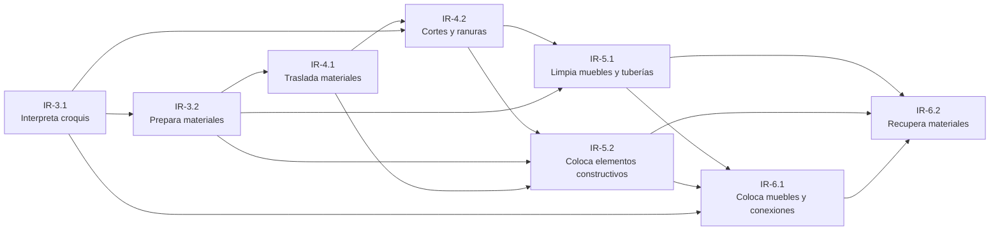

# Malla Curricular y Trayectoria de Instalaciones Residenciales 2024

**Formación Laboral Básico — Bachillerato General Estatal (BGE)**  
**Generación 2023–2026 · Acuerdo 09/08/23**

---

## 1. Ficha técnica

| Campo | Valor |
|---|---|
| Componente | Formación Laboral Básico, Nivel 2 |
| Subsistema | Bachillerato General Estatal (BGE) |
| Generación | 2023–2026 |
| Acuerdo | Acuerdo número 09/08/23 (MCCEMS) |
| Documento oficial | `Instalaciones_Residenciales_2024.pdf` (SEP Puebla, 148 pp.) |
| Páginas de referencia | 16–18 (mapa de competencias), 19 (perfil de egreso), 22–126 (UAC y procesos) |
| Duración | 4 semestres: 3.º, 4.º, 5.º y 6.º |
| UAC | 8 |
| Actividades clave | 24 (3 por UAC) |
| Carga horaria | 432 h: 54 h por UAC, 3 h semanales, 3 bloques de 18 h |
| Ocupaciones | SINCO 2019: 9221 y 9222 · SCIAN 2023: 238130, 238210 y 238221 |
| Proyecto integrador | Taller Comunitario de Instalaciones Residenciales Sustentables |

> **Nota de trazabilidad.** Los nombres de las UAC, las horas, las 24 actividades clave, las ocupaciones SINCO/SCIAN y el perfil de egreso son literales del programa oficial. La secuencia de prerrequisitos y el proyecto integrador son una articulación curricular explícita, validada de forma determinista por `trajectory-validator.ts`.

---

## 2. Presentación de la carrera

El componente de formación laboral **Instalaciones Residenciales** ofrece un acercamiento integral a la construcción e instalaciones hidrosanitarias, eléctricas y de gas de una vivienda. Los estudiantes conocen las instalaciones residenciales básicas, interpretan croquis, preparan materiales, utilizan equipo de seguridad, realizan cortes y ranuras, colocan elementos constructivos, muebles, tuberías y conexiones, y recuperan materiales de reúso y reciclables.

El programa se organiza a partir de competencias laborales requeridas por el sector productivo, en el nivel 2 de competencia: actividades relativamente sencillas, realizadas con supervisión, que movilizan conocimientos, destrezas, habilidades, actitudes y valores en contextos personales, académicos, sociales y laborales.

La formación incorpora de manera transversal las **Habilidades para la Vida y el Trabajo (HVyT)** y los **Conceptos Centrales de la Educación para el Desarrollo Sostenible (CoCEDS)**, con énfasis en la sustentabilidad, el aprovechamiento de los recursos de la región, el cuidado del medio ambiente, la economía solidaria y la identidad cultural.

### 2.1 Justificación oficial

El componente contempla nociones básicas sobre construcción e instalaciones hidrosanitarias, eléctricas y de gas. Los estudiantes conocerán diferentes instalaciones residenciales básicas de una vivienda, interpretarán croquis, prepararán materiales específicos, cuidarán el uso del equipo de seguridad y conocerán la normatividad aplicable a la construcción e instalación residencial básica.

Se valoran temas de gran importancia como las **Instalaciones Residenciales Sustentables**, reflexionando sobre el uso y reúso de materiales. Estas habilidades y conocimientos son el inicio para especializarse en el nivel superior y permiten incorporarse a la creación, organización y seguimiento de pequeñas y medianas empresas, así como a la innovación tecnológica en materia de construcción.

---

## 3. Perfil de egreso

El egresado de Instalaciones Residenciales podrá realizar actividades dirigidas a la interpretación de croquis de cada una de las instalaciones residenciales básicas, la preparación y traslado de materiales, el uso adecuado del equipo de seguridad para realizar cortes y ranuras en construcciones e instalaciones, la colocación de elementos constructivos, muebles, tuberías y conexiones, así como la recuperación de materiales de reúso y reciclables para su utilización.

### 3.1 Competencias laborales de las ocho UAC

1. Interpreta croquis de diferentes instalaciones básicas de una vivienda.
2. Prepara materiales en cantidad y calidad especificada para llevar a cabo diferentes tipos de mezclas bajo la supervisión del experto.
3. Traslada materiales constructivos hacia sitios de trabajo bajo normas de seguridad.
4. Realiza cortes, ranuras en pisos, techos y muros en construcción e instalaciones residenciales.
5. Limpia muebles, tuberías y conexiones para llevar a cabo diferentes instalaciones de una vivienda.
6. Coloca elementos constructivos básicos de una vivienda.
7. Coloca muebles, tuberías y conexiones de acuerdo con instrucciones.
8. Recupera materiales de construcción para su reúso.

### 3.2 Habilidades para la Vida y el Trabajo (HVyT)

| Dimensión | Habilidades |
|---|---|
| Empoderamiento | Regulación de emociones, autoconocimiento y comunicación |
| Empleabilidad | Logro de metas, autonomía y toma de decisiones |
| Aprendizaje | Resolución de problemas, mentalidad de crecimiento y creatividad |
| Ciudadanía | Trabajo en equipo y colaboración, conciencia social y empatía |

### 3.3 Conceptos Centrales de la Educación para el Desarrollo Sostenible (CoCEDS)

- Nexo agua–energía–alimento.
- Servicios ecosistémicos.
- Sistemas socioecológicos.
- Economía ecológica.

---

## 4. Mapa de competencias: 8 UAC y 24 actividades clave

| Semestre | UAC | Horas | Actividades clave | Prerrequisitos |
|---|---|---|---|---|
| 3.º | **IR-3.1** Interpreta croquis de diferentes instalaciones básicas de una vivienda | 54 | 3 × 18 h | — |
| 3.º | **IR-3.2** Prepara materiales en cantidad y calidad especificada para llevar a cabo diferentes tipos de mezclas bajo la supervisión del experto | 54 | 3 × 18 h | IR-3.1 |
| 4.º | **IR-4.1** Traslada materiales constructivos hacia sitios de trabajo bajo normas de seguridad | 54 | 3 × 18 h | IR-3.2 |
| 4.º | **IR-4.2** Realiza cortes, ranuras en pisos, techos y muros en construcción e instalaciones residenciales | 54 | 3 × 18 h | IR-4.1, IR-3.1 |
| 5.º | **IR-5.1** Limpia muebles, tuberías y conexiones para llevar a cabo diferentes instalaciones de una vivienda | 54 | 3 × 18 h | IR-4.2, IR-3.1, IR-3.2 |
| 5.º | **IR-5.2** Coloca elementos constructivos básicos de una vivienda | 54 | 3 × 18 h | IR-4.1, IR-4.2, IR-3.2 |
| 6.º | **IR-6.1** Coloca muebles, tuberías y conexiones de acuerdo con instrucciones | 54 | 3 × 18 h | IR-5.1, IR-5.2, IR-3.1 |
| 6.º | **IR-6.2** Recupera materiales de construcción para su reúso | 54 | 3 × 18 h | IR-5.2, IR-6.1 |

**Total: 8 UAC · 24 actividades clave · 432 horas.**

### 4.1 Ocupaciones y sitios de inserción

| UAC | SINCO 2019 | SCIAN 2023 |
|---|---|---|
| IR-3.1 | 9222 — Trabajadores de apoyo en plomería e instalación de tuberías | 238210, 238221 |
| IR-3.2 | 9222 — Trabajadores de apoyo en plomería e instalación de tuberías | 238210, 238221 |
| IR-4.1 | 9221 — Trabajadores de apoyo en la construcción; 9222 — plomería e instalación de tuberías | 238130, 238210, 238221 |
| IR-4.2 | 9221 — Trabajadores de apoyo en la construcción; 9222 — plomería e instalación de tuberías | 238130, 238210, 238221 |
| IR-5.1 | 9222 — Trabajadores de apoyo en plomería e instalación de tuberías | 238210, 238221 |
| IR-5.2 | 9222 — Trabajadores de apoyo en plomería e instalación de tuberías | 238210, 238221 |
| IR-6.1 | 9222 — Trabajadores de apoyo en plomería e instalación de tuberías | 238210, 238221 |
| IR-6.2 | 9222 — Trabajadores de apoyo en plomería e instalación de tuberías | 238210, 238221 |

---

## 5. Trayectoria DAG de prerrequisitos

La malla se organiza como un grafo acíclico dirigido (DAG). Cada flecha indica que la UAC de origen debe cursarse antes de la UAC de destino. La validación determinista confirma que no existen ciclos y que todos los prerrequisitos son anteriores en el tiempo.



### 5.1 Lectura de la progresión

- **3.º semestre — Diagnóstico y cuantificación.** IR-3.1 instala el lenguaje técnico (instalaciones, espacios y simbología). IR-3.2 convierte ese diagnóstico en materiales, mezclas y costos.
- **4.º semestre — Seguridad y habilitación.** IR-4.1 asegura el traslado y el uso de EPP. IR-4.2 habilita el espacio con cortes y ranuras, articulando la lectura de croquis con la obra.
- **5.º semestre — Acondicionamiento.** IR-5.1 prepara y limpia muebles, tuberías y conexiones. IR-5.2 coloca los elementos constructivos básicos y los accesorios según plano.
- **6.º semestre — Instalación sustentable y cierre.** IR-6.1 integra la instalación residencial sustentable. IR-6.2 cierra el ciclo con la recuperación, el registro y el reúso del material sobrante.

---

## 6. Desglose de las 8 UAC y las 24 actividades clave

> Cada actividad clave tiene una duración de **18 horas**. Los contenidos formativos se declaran por actividad y provienen de los temas oficiales del programa; se almacenan en `programs_catalog.contenidos_formativos` con `source = official_pdf_2024` y `needs_review = false`.

### 6.1 IR-3.1 — Interpreta croquis de diferentes instalaciones básicas de una vivienda

**Semestre:** 3.º · **Horas:** 54 · **Semanal:** 3 h · **Bloques:** 3 · **Prerrequisitos:** ninguno  
**Resultado de aprendizaje:** Interpreta croquis de diferentes instalaciones básicas de una vivienda.  
**Hito del proyecto:** Diagnóstico y croquis del espacio comunitario.

| # | Actividad clave (18 h) | Contenidos formativos | Descripción sintética |
|---|---|---|---|
| 1 | Identifica instalaciones básicas de una vivienda de acuerdo con los diferentes espacios | Instalaciones básicas de una vivienda: eléctrica, hidráulica, sanitaria y de gas; espacios de la vivienda y servicios asociados | Recorrido por una vivienda para identificar instalaciones por espacio; registro en portafolio y tabla comparativa. |
| 2 | Interpreta símbolos para la construcción e instalaciones hidráulicas, de gas y eléctricas | Simbología de construcción e instalaciones | Investigación y comparación de simbología; material visual y plenaria. |
| 3 | Elabora croquis de construcción e instalaciones hidráulicas, de gas y eléctricas de una vivienda bajo la supervisión del experto | Croquis, planos, escalas y dimensiones; lectura e interpretación de planos arquitectónicos | Rediseño de croquis con espacios, dimensiones y simbología, bajo supervisión del experto. |

### 6.2 IR-3.2 — Prepara materiales en cantidad y calidad especificada para llevar a cabo diferentes tipos de mezclas bajo la supervisión del experto

**Semestre:** 3.º · **Horas:** 54 · **Semanal:** 3 h · **Bloques:** 3 · **Prerrequisitos:** IR-3.1  
**Resultado de aprendizaje:** Prepara materiales en cantidad y calidad especificada para llevar a cabo diferentes tipos de mezclas bajo la supervisión del experto.  
**Hito del proyecto:** Cuantificación y selección de materiales.

| # | Actividad clave (18 h) | Contenidos formativos | Descripción sintética |
|---|---|---|---|
| 1 | Verifica materiales de construcción acordes a las necesidades de las instalaciones hidráulicas, de gas y eléctricas | Materiales de construcción para instalaciones hidráulicas, de gas y eléctricas; proveedores, costos y criterios de selección | Registro y clasificación de materiales por instalación; tabla comparativa con fuentes confiables. |
| 2 | Cuantifica materiales como tuberías, conexiones, pegamentos, codos que son necesarios por cada instalación | Cuantificación de tuberías, conexiones, pegamentos y codos; mezclas y proporciones de agregados | Cuantificación por instalación; tabla de doble entrada y costos. |
| 3 | Verifica calidad del material a utilizar de acuerdo con manuales hidrosanitarios, de gas y eléctricos | Certificaciones, sellos y normas de calidad | Verificación de calidad y certificaciones según manuales hidrosanitarios, de gas y eléctricos. |

### 6.3 IR-4.1 — Traslada materiales constructivos hacia sitios de trabajo bajo normas de seguridad

**Semestre:** 4.º · **Horas:** 54 · **Semanal:** 3 h · **Bloques:** 3 · **Prerrequisitos:** IR-3.2  
**Resultado de aprendizaje:** Traslada materiales constructivos hacia sitios de trabajo bajo normas de seguridad.  
**Hito del proyecto:** Plan de seguridad y traslado.

| # | Actividad clave (18 h) | Contenidos formativos | Descripción sintética |
|---|---|---|---|
| 1 | Verifica equipo de seguridad para trasladar materiales de construcción | Equipo de seguridad para construcción e instalaciones | Reconocimiento del EPP para albañilería y traslado; ficha y lista de cotejo. |
| 2 | Utiliza equipo de seguridad para cada proceso de instalación eléctrica, hidrosanitaria y de gas | Riesgos en el traslado y almacenamiento de materiales; manejo manual de cargas y ergonomía | Uso del EPP en procesos de instalación; registro de accidentes e incidentes. |
| 3 | Transporta material con base a normas, reglamentos de seguridad y prevención de riesgos | Normas y reglamentos de seguridad y prevención de riesgos; registro de accidentes e incidentes | Transporte de materiales conforme a normas, reglamentos y prevención de riesgos. |

### 6.4 IR-4.2 — Realiza cortes, ranuras en pisos, techos y muros en construcción e instalaciones residenciales

**Semestre:** 4.º · **Horas:** 54 · **Semanal:** 3 h · **Bloques:** 3 · **Prerrequisitos:** IR-4.1, IR-3.1  
**Resultado de aprendizaje:** Realiza cortes, ranuras en pisos, techos y muros en construcción e instalaciones residenciales.  
**Hito del proyecto:** Habilitación de cortes y ranuras.

| # | Actividad clave (18 h) | Contenidos formativos | Descripción sintética |
|---|---|---|---|
| 1 | Organiza equipo y herramientas por categorías y uso residencial | Herramientas y equipo de albañilería e instalaciones | Clasificación de herramientas y equipo por categoría y uso residencial. |
| 2 | Realiza cortes y ranuras para la construcción bajo las indicaciones del experto | Cortes y ranuras en muros, pisos y techos; grietas y criterios de intervención | Cortes y ranuras en muros, pisos y techos; selección de herramienta y equipo. |
| 3 | Realiza cortes, ranuras en instalaciones hidráulicas, eléctricas y de gas bajo las indicaciones del experto | Cortes y ranuras en instalaciones hidráulicas, eléctricas y de gas; uniones, sellado y acabados | Cortes y ranuras en instalaciones; uniones, sellado y acabados. |

### 6.5 IR-5.1 — Limpia muebles, tuberías y conexiones para llevar a cabo diferentes instalaciones de una vivienda

**Semestre:** 5.º · **Horas:** 54 · **Semanal:** 3 h · **Bloques:** 3 · **Prerrequisitos:** IR-4.2, IR-3.1, IR-3.2  
**Resultado de aprendizaje:** Limpia muebles, tuberías y conexiones para llevar a cabo diferentes instalaciones de una vivienda.  
**Hito del proyecto:** Limpieza y preparación de muebles, tuberías y conexiones.

| # | Actividad clave (18 h) | Contenidos formativos | Descripción sintética |
|---|---|---|---|
| 1 | Considera formas y manejo de los muebles, tuberías y conexiones para la construcción e instalaciones residenciales | Muebles, tuberías y conexiones: formas y manejo; áreas y zonas de trabajo para instalaciones | Reconocimiento de formas y manejo; tendido de redes residenciales y portafolio. |
| 2 | Clasifica materiales de plomería, hidráulica e instalaciones de gas de acuerdo con las dimensiones de la vivienda y los muebles | Materiales de plomería, hidráulica y gas | Clasificación de materiales según dimensiones de la vivienda y los muebles. |
| 3 | Utiliza materiales y equipo para la limpieza de muebles, tuberías y conexiones | Limpieza de muebles, tuberías y conexiones; productos de limpieza y medidas de seguridad | Uso de materiales y equipo de limpieza; productos y seguridad. |

### 6.6 IR-5.2 — Coloca elementos constructivos básicos de una vivienda

**Semestre:** 5.º · **Horas:** 54 · **Semanal:** 3 h · **Bloques:** 3 · **Prerrequisitos:** IR-4.1, IR-4.2, IR-3.2  
**Resultado de aprendizaje:** Coloca elementos constructivos básicos de una vivienda.  
**Hito del proyecto:** Colocación de elementos constructivos básicos.

| # | Actividad clave (18 h) | Contenidos formativos | Descripción sintética |
|---|---|---|---|
| 1 | Reúne elementos constructivos básicos de una vivienda | Elementos constructivos básicos: cimentación, cadenas, castillos, muros, losas y acabados; agregados: arena, cemento, grava, mortero y agua | Identificación de elementos constructivos básicos y agregados. |
| 2 | Traslada materiales requeridos al sitio de la obra | Procesos de construcción de una vivienda; traslado de materiales al sitio de la obra | Análisis de agregados y traslado de materiales al sitio de la obra. |
| 3 | Instala muebles y accesorios de acuerdo con lo especificado en el plano | Instalación de muebles y accesorios según plano | Instalación de muebles y accesorios conforme al plano. |

### 6.7 IR-6.1 — Coloca muebles, tuberías y conexiones de acuerdo con instrucciones

**Semestre:** 6.º · **Horas:** 54 · **Semanal:** 3 h · **Bloques:** 3 · **Prerrequisitos:** IR-5.1, IR-5.2, IR-3.1  
**Resultado de aprendizaje:** Coloca muebles, tuberías y conexiones de acuerdo con instrucciones.  
**Hito del proyecto:** Instalación sustentable de muebles, tuberías y conexiones.

| # | Actividad clave (18 h) | Contenidos formativos | Descripción sintética |
|---|---|---|---|
| 1 | Clasifica instalaciones sustentables de electricidad, hidrosanitarias y de gas | Instalaciones residenciales sustentables: hidrosanitaria, eléctrica y gas | Clasificación de instalaciones residenciales sustentables. |
| 2 | Verifica viabilidad del espacio para la instalación sustentable | Viabilidad del espacio y criterios de sustentabilidad; documentación técnica y especificaciones | Verificación de viabilidad del espacio; recorrido y lista de cotejo. |
| 3 | Elabora croquis de la instalación residencial sustentable | Croquis de la instalación residencial sustentable; colocación de muebles, tuberías y conexiones | Elaboración de croquis con dimensiones y especificaciones. |

### 6.8 IR-6.2 — Recupera materiales de construcción para su reúso

**Semestre:** 6.º · **Horas:** 54 · **Semanal:** 3 h · **Bloques:** 3 · **Prerrequisitos:** IR-5.2, IR-6.1  
**Resultado de aprendizaje:** Recupera materiales de construcción para su reúso.  
**Hito del proyecto:** Recuperación y reúso de material sobrante.

| # | Actividad clave (18 h) | Contenidos formativos | Descripción sintética |
|---|---|---|---|
| 1 | Clasifica material sobrante durante la construcción o instalación residencial | Clasificación de material sobrante de construcción e instalación; economía circular en la construcción | Clasificación del material sobrante; las tres R. |
| 2 | Registra material sobrante en una bitácora, acorde con especificaciones del especialista | Bitácora de material sobrante | Registro del material sobrante conforme a las especificaciones del especialista. |
| 3 | Reutiliza material sobrante de manera sustentable | Reutilización y reciclaje: las tres R; disposición final de residuos | Reutilización del material sobrante; diseño e innovación. |

---

## 7. Proyecto integrador: Taller Comunitario de Instalaciones Residenciales Sustentables

**Descripción.** Proyecto integrador de dos años que articula las ocho UAC en la mejora de un espacio comunitario real, con instalación residencial básica documentada, segura y sustentable.

**Producto final.** Espacio comunitario con instalación residencial básica (hidrosanitaria, eléctrica y de gas) documentada, segura y con recuperación de material sobrante.

| Semestre | Hito | UAC vinculadas | Evidencia | Descripción |
|---|---|---|---|---|
| 3.º | Diagnóstico y croquis del espacio comunitario | IR-3.1, IR-3.2 | Croquis con simbología, tabla de instalaciones y cuantificación de materiales | Levantamiento de instalaciones y espacios, interpretación de simbología y cuantificación de materiales necesarios. |
| 4.º | Preparación segura y habilitación del espacio | IR-4.1, IR-4.2 | Checklist de EPP, plan de traslado y registro fotográfico de cortes y ranuras | Plan de seguridad y traslado de materiales, organización de herramientas y ejecución de cortes y ranuras. |
| 5.º | Acondicionamiento y colocación de elementos constructivos | IR-5.1, IR-5.2 | Bitácora de limpieza, elementos constructivos colocados y muebles/accesorios instalados | Limpieza y preparación de muebles, tuberías y conexiones, y colocación de elementos constructivos básicos. |
| 6.º | Instalación sustentable y recuperación de sobrantes | IR-6.1, IR-6.2 | Croquis de instalación sustentable, instalación colocada y bitácora de reúso | Colocación de muebles, tuberías y conexiones con criterios de sustentabilidad, y recuperación de material sobrante. |

### 7.1 Matriz de articulación curricular

| UAC | Aporte al proyecto | Producto parcial |
|---|---|---|
| IR-3.1 | Diagnóstico del espacio y lectura de croquis | Croquis del espacio comunitario |
| IR-3.2 | Cuantificación y selección de materiales | Tabla de materiales y costos |
| IR-4.1 | Seguridad y traslado | Plan de seguridad y checklist de EPP |
| IR-4.2 | Habilitación del espacio | Registro de cortes y ranuras |
| IR-5.1 | Limpieza y preparación | Bitácora de limpieza y preparación |
| IR-5.2 | Colocación de elementos constructivos | Elementos y accesorios instalados |
| IR-6.1 | Instalación sustentable | Croquis e instalación sustentable |
| IR-6.2 | Recuperación y reúso | Bitácora de material sobrante y reúso |

---

## 8. Trazabilidad, validación y reproducción

### 8.1 Validación de la malla

```bash
npx tsx scripts/validate-instalaciones-trajectory.ts
```

Resultado esperado:

- 8 UAC, 2 por semestre (3.º a 6.º).
- 24 actividades clave, 3 por UAC, 18 h cada una.
- 432 h totales, 54 h por UAC, 3 h semanales y 3 bloques.
- DAG sin ciclos y prerrequisitos siempre anteriores.
- 4 hitos del proyecto, uno por semestre, con cobertura exacta de las 8 UAC.

### 8.2 Validación del catálogo

```bash
npx tsx scripts/audit-instalaciones-catalog.ts
```

Resultado esperado:

- 8/8 UAC presentes en `programs_catalog`.
- 3 actividades y 3 entradas de contenidos por UAC.
- 54 h por UAC y coincidencia de nombres oficiales.

### 8.3 Enriquecimiento de contenidos

```bash
npx tsx scripts/enrich-instalaciones-contents.ts          # dry-run
npx tsx scripts/enrich-instalaciones-contents.ts --apply  # respaldo + escritura
```

El modo `--apply` crea una tabla de respaldo `programs_catalog_backup_p1_2_<timestamp>` antes de actualizar. En esta ejecución el respaldo quedó en `programs_catalog_backup_p1_2_1794423651797`.

Estado verificado después de P1.2:

- 8/8 UAC con `contenidos_formativos` canónicos.
- 3 entradas por UAC, una por actividad clave.
- `source = official_pdf_2024` y `needs_review = false`.
- Nombre oficial de IR-6.2 normalizado a **“Recupera materiales de construcción para su reúso”**.

### 8.4 Pruebas automatizadas

```bash
npx tsc --noEmit
npx vitest run
```

La suite completa se mantiene en verde: **2,133 pruebas aprobadas, 7 omitidas, 257 archivos** al cierre de P1.2. Incluye pruebas específicas para los contenidos por actividad y la generación canónica de `contenidos_formativos`.

---

## 9. Fuentes oficiales y referencias normativas

- SEP Puebla. (2024). *Instalaciones Residenciales*. Programa de estudio de Formación Laboral Básico, Generación 2023–2026. `Instalaciones_Residenciales_2024.pdf`.
- Acuerdo número 09/08/23 por el que se establece, regula y modifica el Marco Curricular Común de la Educación Media Superior.
- SINCO 2019: 9221 — Trabajadores de apoyo en la construcción; 9222 — Trabajadores de apoyo en plomería e instalación de tuberías.
- SCIAN 2023: 238130 — Trabajos de albañilería; 238210 — Instalaciones eléctricas en construcciones; 238221 — Instalaciones hidrosanitarias y de gas.
- NOM-031-STPS-2011. Construcción — Condiciones de seguridad y salud en el trabajo.
- ISO 9001:2015. Sistemas de gestión de calidad — Requisitos.
- CONAGUA. Información técnica y normativa sobre agua e instalaciones hidráulicas.
- STPS. Seguridad y salud en el trabajo.

---

## 10. Nota de revisión humana

Este documento integra información oficial del programa y una articulación curricular validada. Antes de su uso institucional definitivo, se recomienda la revisión de la **Academia Estatal de Formación Laboral y TIC — Coordinación de Zona Escolar**, particularmente en lo relativo a:

- Pertinencia de los prerrequisitos y del proyecto integrador en el contexto de cada plantel.
- Vinculación con el PAEC y con las condiciones reales del espacio comunitario.
- Actualización normativa y de seguridad aplicable a los trabajos de instalaciones residenciales.

---

**Fin del documento.**
